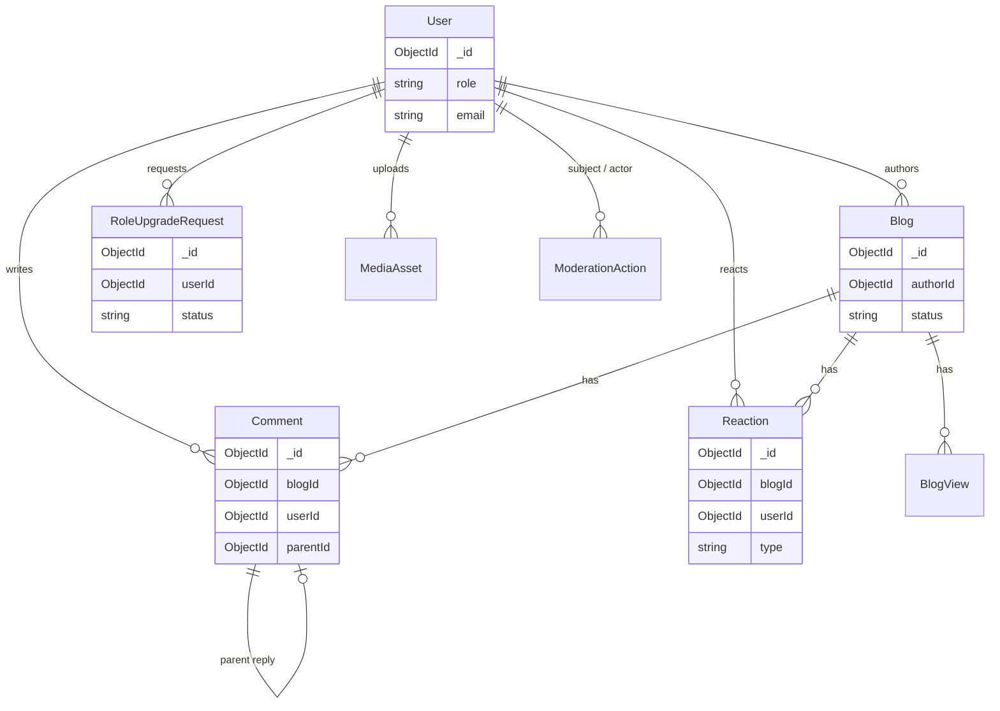

# Blogiz — MongoDB / Mongoose Schema Design

This document defines the NoSQL data model for the product described in [PLAN.md](PLAN.md). Collections are chosen so that high-cardinality or independently queried data (comments, reactions, upgrade requests) stay as separate documents; counters and profile fields that are always loaded with a parent may be embedded or denormalized.

**Roles (exactly three):** `admin` | `author` | `reader`  
Reader maps to the stored enum value **`reader`** (not `user`).

Conventions:

- Document `_id` is `ObjectId` unless noted.
- Foreign keys use `Schema.Types.ObjectId` with `ref`.
- `timestamps: true` → `createdAt`, `updatedAt` on mutable collections.
- String enums listed explicitly.
- Indexes listed per collection; compound indexes match common query paths.

---

## Relationship overview



**Refs vs embed (summary)**

| Data | Approach | Why |
| --- | --- | --- |
| Profile fields, avatar URL, suspension flags | Embedded on `User` | Always loaded with the account |
| Blog body, tags, denormalized counts | On `Blog` | Single-document read for post pages |
| Comments / replies | Separate `Comment` + `parentId` | Unbounded threads; paginate independently |
| Reactions | Separate `Reaction` | Unique constraint per user/blog; aggregate counts |
| Role upgrades | Separate `RoleUpgradeRequest` | Admin queue + history |
| Media metadata | Optional `MediaAsset` | Track Cloudinary public IDs for cleanup |
| Moderation history | Optional `ModerationAction` | Audit trail beyond flags on User |

---

## 1. `users`

Mongoose model: `User` → collection `users`.

| Field | Type | Notes |
| --- | --- | --- |
| `email` | `String` | Required, unique, lowercase, trim |
| `password` | `String` | Required, bcrypt hash; never return in API |
| `name` | `String` | Display / login name; required, trim |
| `role` | `String` enum | `admin` \| `author` \| `reader`; default `reader` |
| `profile` | `Object` (embedded) | See below |
| `isActive` | `Boolean` | Default `true`; `false` = suspended/deactivated (no sign-in) |
| `commentSuspended` | `Boolean` | Default `false`; blocks new comments/replies |
| `commentSuspendedAt` | `Date` | Optional |
| `commentSuspendedReason` | `String` | Optional, max ~500 |
| `commentSuspendedBy` | `ObjectId` → `User` | Admin who applied the flag |
| `emailVerified` | `Boolean` | Default `false` |
| `sessionVersion` | `Number` | Default `0`; bump to invalidate sessions |
| `emailVerificationTokenHash` | `String` | Optional |
| `emailVerificationExpires` | `Date` | Optional |
| `passwordResetTokenHash` | `String` | Optional |
| `passwordResetExpires` | `Date` | Optional |
| `pendingEmail` | `String` | Optional email-change flow |
| `createdAt` / `updatedAt` | `Date` | Timestamps |

### Embedded `profile`

| Field | Type | Notes |
| --- | --- | --- |
| `fullName` | `String` | Required, trim |
| `bio` | `String` | Default `""`, max ~500 |
| `avatar` | `String` | HTTPS URL (Cloudinary or similar); default `""` |
| `avatarPublicId` | `String` | Optional; for media delete/replace |
| `website` | `String` | Optional |
| `socialLinks` | `Object` | Optional `twitter`, `linkedin`, `github` strings |
| `location` | `String` | Optional |
| `expertise` | `[String]` | Optional tags |

### Indexes

- Unique: `email`
- `{ role: 1 }`
- `{ isActive: 1, role: 1 }`
- `{ commentSuspended: 1 }` (admin queues)

### Authz notes

- Default registration → `role: "reader"`.
- Approving a role-upgrade sets `role: "author"`.
- Admins may set `role` to `admin` | `author` | `reader` with server-side safeguards (e.g. cannot demote the last admin).

---

## 2. `blogs`

Mongoose model: `Blog` → collection `blogs`.

| Field | Type | Notes |
| --- | --- | --- |
| `title` | `String` | Required, trim, max ~200 |
| `description` | `String` | Short summary / SEO description; max ~500 |
| `content` | `String` | Body (Markdown or HTML as app chooses); max ~100000 |
| `authorId` | `ObjectId` → `User` | Required; owner |
| `authorName` | `String` | Denormalized display name at publish/edit time |
| `thumbnail` | `String` | Image URL; optional until set/generated |
| `thumbnailPublicId` | `String` | Optional cloud public id |
| `thumbnailSource` | `String` enum | Optional: `upload` \| `ai` \| `none` |
| `status` | `String` enum | `draft` \| `published`; default `draft` |
| `publishedAt` | `Date` | Set when first published; null while draft |
| `tags` | `[String]` | Trim, lowercase |
| `readingTime` | `Number` | Minutes; computed from content |
| `totalLikes` | `Number` | Default `0` (denormalized) |
| `totalDislikes` | `Number` | Default `0` |
| `totalComments` | `Number` | Default `0` (visible/approved comments) |
| `totalViews` | `Number` | Default `0` |
| `createdBy` | `ObjectId` → `User` | Usually same as `authorId`; kept for audit |
| `createdAt` / `updatedAt` | `Date` | Timestamps |

Public listing queries: `{ status: "published" }` sorted by `publishedAt` descending.

AI optimize flows **do not** require extra collections: optimized title/content are written back to `title` / `content` only after the author accepts (or applied into the editor client-side first). Optional future: `aiSuggestions` subdoc for pending accept/reject — not required for v1.

### Indexes

- `{ status: 1, publishedAt: -1 }`
- `{ authorId: 1, status: 1, updatedAt: -1 }`
- `{ createdBy: 1 }`
- `{ tags: 1 }`
- Text index (optional): `title`, `description`, `content` for search

---

## 3. `comments`

Mongoose model: `Comment` → collection `comments`.

| Field | Type | Notes |
| --- | --- | --- |
| `blogId` | `ObjectId` → `Blog` | Required |
| `userId` | `ObjectId` → `User` | Required |
| `content` | `String` | Required, trim, max ~1000 |
| `parentId` | `ObjectId` → `Comment` | `null` = top-level; set for replies |
| `isVisible` | `Boolean` | Default `true`; author/admin can hide |
| `isEdited` | `Boolean` | Default `false` |
| `editedAt` | `Date` | Optional |
| `createdAt` / `updatedAt` | `Date` | Timestamps |

Replies are the same collection (adjacency list via `parentId`). Cap nesting in application logic (e.g. one or two levels) even if the schema allows deeper trees.

Authors manage comments where `blog.authorId === session.userId`. Admins manage any comment. Creating a comment requires `!user.commentSuspended` and `user.isActive`.

### Indexes

- `{ blogId: 1, createdAt: -1 }`
- `{ blogId: 1, isVisible: 1, createdAt: -1 }`
- `{ userId: 1 }`
- `{ parentId: 1 }`

---

## 4. `reactions`

Mongoose model: `Reaction` (collection name `reactions`; legacy code may still say `Like` — prefer `Reaction` going forward).

One document per user per blog; toggling updates `type` or deletes the document.

| Field | Type | Notes |
| --- | --- | --- |
| `blogId` | `ObjectId` → `Blog` | Required |
| `userId` | `ObjectId` → `User` | Required |
| `type` | `String` enum | `like` \| `dislike` |
| `createdAt` / `updatedAt` | `Date` | Timestamps |

Maintain `Blog.totalLikes` / `totalDislikes` in the same transaction/session or carefully ordered updates when reaction changes.

### Indexes

- Unique compound: `{ blogId: 1, userId: 1 }`
- `{ blogId: 1, type: 1 }`

---

## 5. `roleupgraderequests`

Mongoose model: `RoleUpgradeRequest` → collection `roleupgraderequests`.

Used for **Reader → Author** requests (`requestedRole: "author"` only in this plan).

| Field | Type | Notes |
| --- | --- | --- |
| `userId` | `ObjectId` → `User` | Required |
| `requestedRole` | `String` enum | `author` (only) |
| `currentRole` | `String` enum | Expected `reader` at request time |
| `reason` | `String` | Required, max ~1000 |
| `status` | `String` enum | `pending` \| `approved` \| `rejected`; default `pending` |
| `reviewedBy` | `ObjectId` → `User` | Admin reviewer |
| `reviewedAt` | `Date` | Optional |
| `rejectionReason` | `String` | Optional, max ~500 |
| `createdAt` / `updatedAt` | `Date` | Timestamps |

On approve: set `User.role = "author"`, mark request `approved`. On reject: keep `reader`, store reason.

### Indexes

- `{ userId: 1 }`
- Unique partial: `{ userId: 1 }` where `status: "pending"` (one open request per user)
- `{ status: 1, createdAt: -1 }`
- `{ requestedRole: 1, status: 1 }`

---

## 6. `mediaassets` (optional but recommended)

Mongoose model: `MediaAsset` → collection `mediaassets`.

Tracks uploaded/generated images so Admin cleanup and avatar/thumbnail replacement can delete orphans from the CDN.

| Field | Type | Notes |
| --- | --- | --- |
| `ownerId` | `ObjectId` → `User` | Required |
| `url` | `String` | Required HTTPS URL |
| `publicId` | `String` | Cloudinary (or provider) public id |
| `kind` | `String` enum | `avatar` \| `blog_thumbnail` \| `other` |
| `blogId` | `ObjectId` → `Blog` | Optional; set for thumbnails |
| `source` | `String` enum | `upload` \| `ai` |
| `bytes` | `Number` | Optional |
| `width` / `height` | `Number` | Optional |
| `createdAt` / `updatedAt` | `Date` | Timestamps |

### Indexes

- `{ ownerId: 1, kind: 1 }`
- `{ blogId: 1 }`
- `{ publicId: 1 }` unique sparse

Avatars may also store `url` / `publicId` only on `User.profile` without a `MediaAsset` row; the separate collection is preferred when you need listing and garbage collection.

---

## 7. Suspensions & moderation

### Flags on `User` (primary enforcement)

- Account suspend: `isActive: false` (+ optional reason fields if you extend the schema).
- Comment suspend: `commentSuspended`, `commentSuspendedAt`, `commentSuspendedReason`, `commentSuspendedBy`.

### `moderationactions` (audit log)

Mongoose model: `ModerationAction` → collection `moderationactions`.

| Field | Type | Notes |
| --- | --- | --- |
| `actorId` | `ObjectId` → `User` | Admin performing the action |
| `subjectUserId` | `ObjectId` → `User` | Optional; user affected |
| `subjectBlogId` | `ObjectId` → `Blog` | Optional |
| `subjectCommentId` | `ObjectId` → `Comment` | Optional |
| `action` | `String` enum | See below |
| `reason` | `String` | Optional |
| `metadata` | `Mixed` | Optional extras (e.g. previous role) |
| `createdAt` | `Date` | Timestamp (immutable log; `updatedAt` optional) |

Suggested `action` values:

`suspend_user` · `unsuspend_user` · `suspend_commenting` · `unsuspend_commenting` · `reset_password` · `delete_user` · `delete_blog` · `unpublish_blog` · `hide_comment` · `delete_comment` · `approve_role_upgrade` · `reject_role_upgrade`

### Indexes

- `{ subjectUserId: 1, createdAt: -1 }`
- `{ actorId: 1, createdAt: -1 }`
- `{ action: 1, createdAt: -1 }`

---

## 8. `blogviews` (analytics support)

Mongoose model: `BlogView` → collection `blogviews`.

| Field | Type | Notes |
| --- | --- | --- |
| `blogId` | `ObjectId` → `Blog` | Required |
| `userId` | `ObjectId` → `User` | Optional (anonymous allowed) |
| `ipHash` | `String` | Salted hash only; never raw IP |
| `sessionId` | `String` | Optional |
| `viewedAt` | `Date` | Default now |

### Indexes

- `{ blogId: 1, viewedAt: -1 }`
- `{ userId: 1, viewedAt: -1 }`
- TTL on `viewedAt` (e.g. 90 days) optional for retention

Increment `Blog.totalViews` according to dedupe rules (e.g. once per user/session per day).

---

## 9. Collections intentionally deferred

| Collection | Status |
| --- | --- |
| Marketing `banners` | Not required by the core plan; add later if the marketing site needs CMS banners |
| Notification inbox | Later phase |
| Full-text search sidecar | Optional; start with MongoDB text index |

---

## Field naming (Mongoose conventions)

Prefer **camelCase** on schemas (`authorId`, `totalLikes`, `publishedAt`, `commentSuspended`) rather than snake_case. Keep API DTOs aligned with schema names where practical.

Role enum in code:

```ts
type Role = "admin" | "author" | "reader";
```

Blog status for the plan’s draft/publish workflow:

```ts
type BlogStatus = "draft" | "published";
```

(If a future approval gate is added, extend with `pending` / `rejected` without breaking published documents.)

---

## Example ownership queries

```ts
// Author's blogs
Blog.find({ authorId: userId }).sort({ updatedAt: -1 });

// Published feed
Blog.find({ status: "published" }).sort({ publishedAt: -1 });

// Thread roots for a post
Comment.find({ blogId, parentId: null, isVisible: true }).sort({ createdAt: -1 });

// Replies
Comment.find({ parentId: commentId, isVisible: true });

// Pending author applications
RoleUpgradeRequest.find({ status: "pending", requestedRole: "author" }).sort({ createdAt: 1 });

// Enforce comment ban
if (user.commentSuspended || !user.isActive) throw forbidden();
```

---

## Seed / bootstrap expectations

- At least one `admin` user for operations.
- Sample `reader` and `author` accounts.
- Mix of `draft` and `published` blogs.
- Nested comments, reactions, and one `pending` role-upgrade request.
- Truncate-all + reseed is acceptable for local/dev databases only.

See [GUIDE.md](GUIDE.md) for environment variables and seed commands once implemented.
